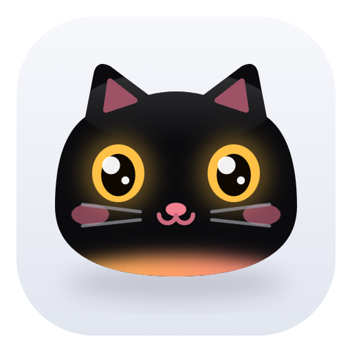

<p align="center">
  
</p>

<h1 align="center">Purrch</h1>

<p align="center">A cat that lives in your notch.</p>

<p align="center">
  <a href="https://github.com/Shaiyon69/purrch/releases/latest"></a>
  <a href="LICENSE"></a>
  
</p>

<p align="center">
  <a href="#install">Install</a> · <a href="#build">Build</a> · <a href="#your-data">Your data</a>
</p>

Purrch sits at the top of your screen as a small pill and opens into a panel when you hover over it.

## Features

- **Water**: spreads your daily goal into small sips across your working hours, nudges you when one is due, and tells you when your bottle is probably empty. Snooze, a bottle tracker and an hourly chart are included.
- **Focus**: a Pomodoro timer. 25 minutes of focus, 5-minute breaks, and a 15-minute break after every fourth session.
- **To-do**: a quick task list. Add `@14:30` to a task to get a reminder at that time.
- **Shelf**: drop files, links or text on the notch to keep them handy, then drag them back out into any app.
- **Music**: shows what's playing in any app that reports to Windows media controls (MPRIS on Linux), with album art, controls and synced lyrics from [LRCLIB](https://lrclib.net).
- **Pop-ups**: charger plugged in or out, low battery, Caps Lock, internet lost or back, Bluetooth devices connecting. While an app uses the microphone or camera, the cat puts on a headset whose mic glows orange (mic) or green (camera; mic only on Linux).
- **The cat**: follows your cursor with its eyes and falls asleep when you step away. After a long nap it wanders off to sleep on the taskbar, and comes back when you return (Windows).
- **Feed the cat**: sips, finished tasks and Focus sessions feed it; left hungry it turns grumpy. Good days (8 feeds) in a row earn it a bell, then a scarf.
- **Music lights**: as soon as music plays, the closed pill's outline glows softly white while thin lights glide around it in both directions, a little faster when the music is loud; the cat nods on the beat (Windows).
- **Clipboard peek**: copy a hex colour, a link or a sum like `12*7+3`, and the pill shows the swatch, the site or the answer (Windows).
- **Screenshot catcher**: a Win+Shift+S snip lands in the Shelf on its own.
- **Colour picker**: press Ctrl+Alt+C and keep holding Ctrl+Alt; the cat's eyes take the colour under the cursor, and letting go copies its hex code.
- **Stays out of the way**: the notch hides itself while a full-screen app is in front.

### Tray

Right-click the tray icon for *Start with Windows* (*Start on login* on Linux), *Show the cat*, *Compact notch* and *Quit*.

## Install

Download `PurrchSetup.exe` from the [latest release](https://github.com/Shaiyon69/purrch/releases/latest) and run it. It installs for your user only, with no admin prompt, and adds Purrch to the Start menu. Windows 10 or 11, 64-bit.

> [!NOTE]
> The installer is not code-signed yet, so Windows SmartScreen may warn you. Click *More info*, then *Run anyway*.

### Linux (preview)

Download `Purrch-x86_64.AppImage`, make it executable (`chmod +x Purrch-x86_64.AppImage`) and run it. It needs glibc 2.39 or newer (Ubuntu 24.04, Fedora 40, Arch and later).

- **Wayland**: the notch is a layer-shell surface (KDE Plasma, Sway, Hyprland and other wlroots compositors). GNOME has no layer-shell, so there Purrch runs through XWayland instead.
- **X11**: needs a compositor for the transparent corners.
- **Tray**: KDE and most panels show it. GNOME needs the AppIndicator extension; without a tray, quit with `pkill purrch`.
- **Volume and outputs** use `pactl` (PulseAudio, or PipeWire's `pipewire-pulse`). **Lyrics and web album art** use `curl`.
- **Differences from Windows**: on Wayland the cat's eyes follow the cursor only over the notch, and full-screen apps cover the notch instead of it sliding away. Shelf thumbnails show image previews only, and the icons are standard symbols instead of Segoe Fluent Icons.

## Build

### Windows

Requires Windows 10 or 11 and Rust with the MSVC toolchain (including the Windows SDK, which embeds the icon).

```powershell
cargo build --release
cargo test
```

The app is `target\release\purrch.exe`. To build the installer, install [Inno Setup 6](https://jrsoftware.org/isinfo.php) and run:

```powershell
iscc installer.iss
```

It writes `dist\PurrchSetup.exe`.

### Linux

Requires Rust plus GTK 4.12+ and [gtk4-layer-shell](https://github.com/wmww/gtk4-layer-shell) development files. Ubuntu 24.04 has GTK but not gtk4-layer-shell, so CI builds that from source (see the workflow); distributions that package it (Arch, Fedora, Ubuntu 25.04+) need only:

```sh
cargo build --release
cargo test
```

The app is `target/release/purrch`. CI builds the AppImage with [linuxdeploy](https://github.com/linuxdeploy/linuxdeploy); see `.github/workflows/linux.yml`.

## Your data

Everything stays on your machine, as plain text in `%APPDATA%\Purrch\` (Linux: `~/.config/purrch/`):

| File | Contents |
|---|---|
| `settings.txt` | cat and compact-mode toggles |
| `water.txt` | bottle, goal, hours and today's progress |
| `todo.txt` | tasks, one per line |
| `shelf.txt` | paths of shelved items |
| `pet.txt` | how fed the cat is and its good-day streak |

Dropped links, text snippets and caught screenshots are saved as files in `%LOCALAPPDATA%\Purrch\Shelf\` (Linux: `~/.local/share/purrch/shelf/`).

> [!TIP]
> The only network request Purrch makes is the lyrics lookup to lrclib.net, which sends the song title and artist. On Linux, album art that a player provides as a web link (Spotify, browsers) is also downloaded from that link.

## License

MIT. See [LICENSE](LICENSE).
